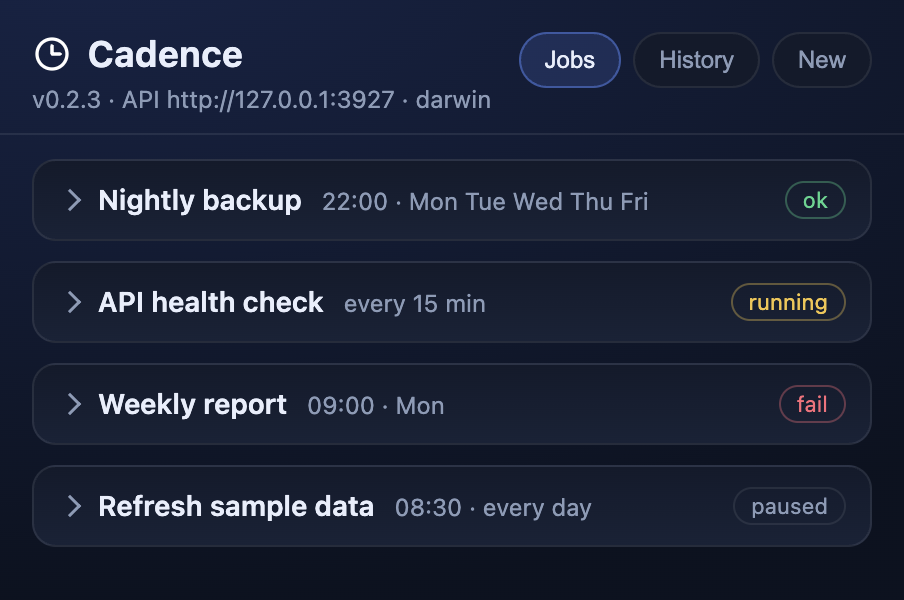
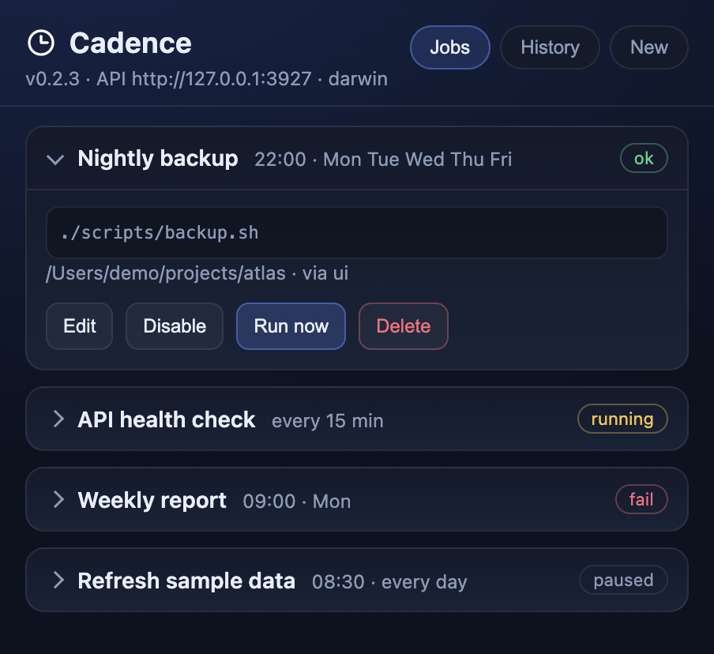
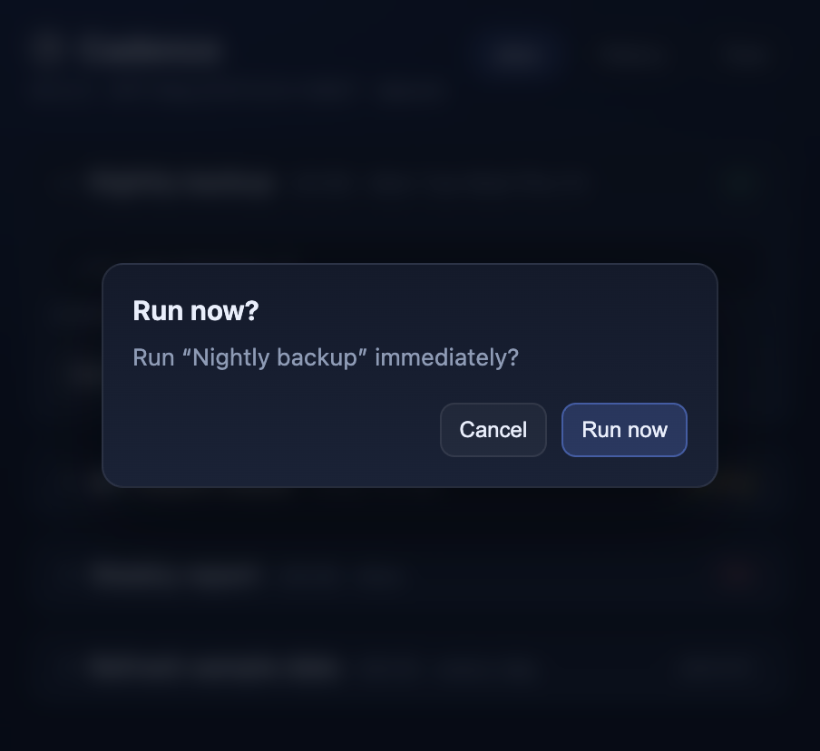
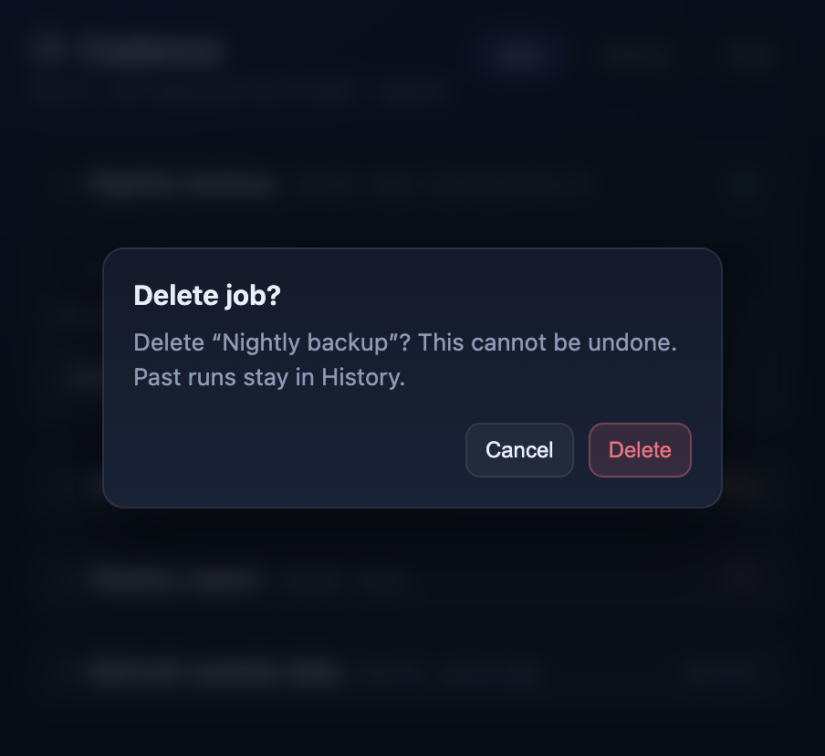
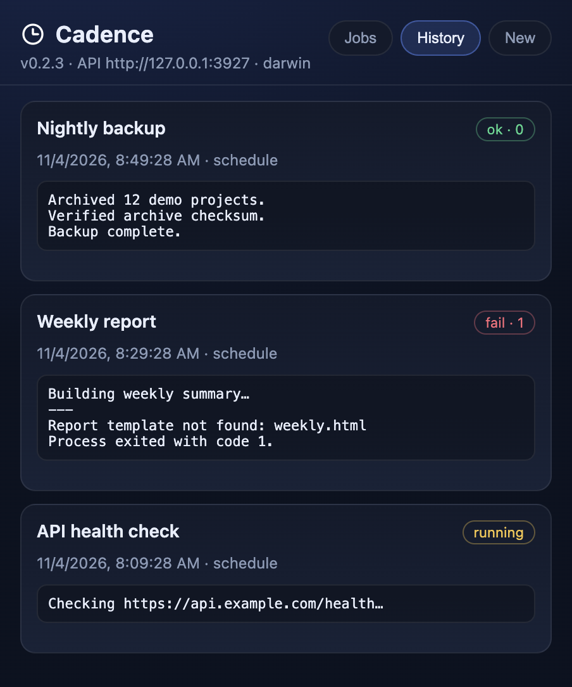
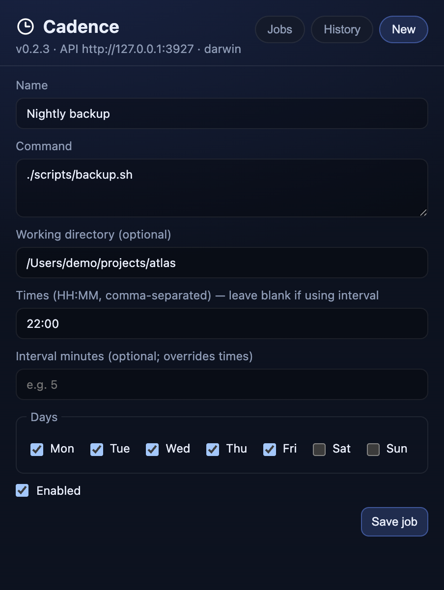
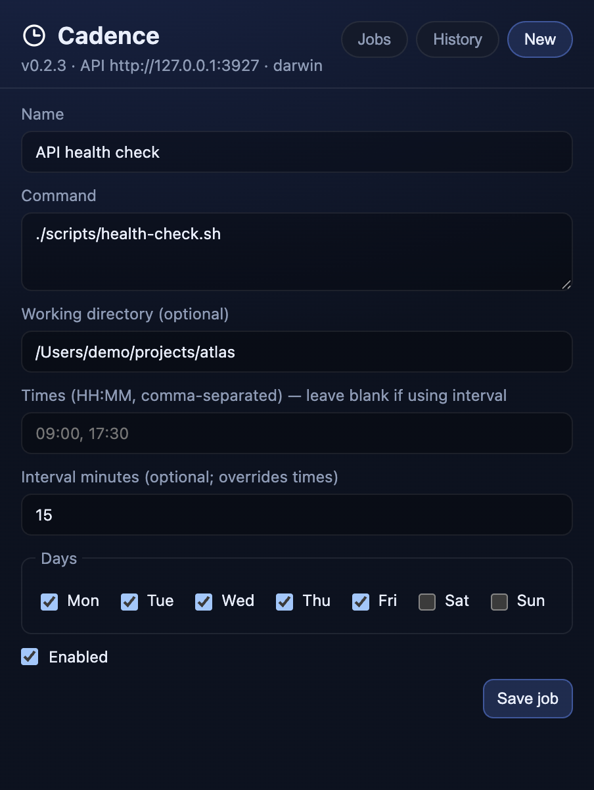

# Screenshot gallery

Screenshots of the current Electron interface on macOS, using fictional projects, accounts, jobs, and values. No personal data or live credentials are used.

These are captures of `dist/index.html` built from the repository’s actual `src/ui` code. The layout, typography, colors, controls, and dialogs come from the app. A separate Electron entry point supplies synthetic state through a mock preload bridge; it never starts the production main process. Network requests are blocked, and application data goes to a temporary directory. Actions such as run, delete, merge, refresh, and save are inert.

No installed app, sign-in, API key, real repository scan, market-data request, or scheduled command is needed. Example stock prices, allowance percentages, balances, and positions are illustrative. There are no AI-generated interface images.

Captured from version **0.2.3**, source revision `c8dcc95`.

## Recreate

From the repository root, after installing dependencies:

```bash
npm install
npm run build:ui
npm run build:electron
npx electron scripts/screenshots.cjs
```

Run this on macOS with a graphical session for the same fonts and platform controls. The capture window is hidden and uses a 2× device scale. Other platforms can render different fonts and native controls. Dates and relative times are sample data and may differ when recaptured.

`scripts/screenshots/fixture.cjs` defines every sample and the click sequence. `preload.cjs` provides the isolated mock bridge. `manifest.json` lists each image, its purpose, and its pixel size. Do not replace the fixture bridge with the production preload when capturing public documentation.

## Views

### Jobs

Scheduled jobs with passing, running, failed, and paused states.



### Job Details

Expanded job: command, schedule, enable/disable, run, and delete actions.



### Run Confirmation

Run-now confirmation before a command is executed.



### Delete Confirmation

Delete-job confirmation with the actual destructive-action wording.



### History

Run history with status, exit codes, stdout, and stderr.



### New Job

New calendar job: command, directory, times, weekdays, and enabled state.



### Interval Job

Interval scheduling uses the same New form.


